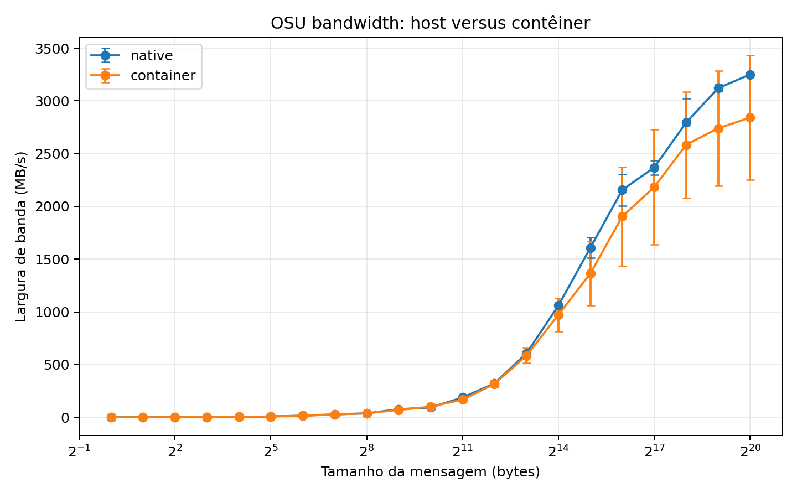
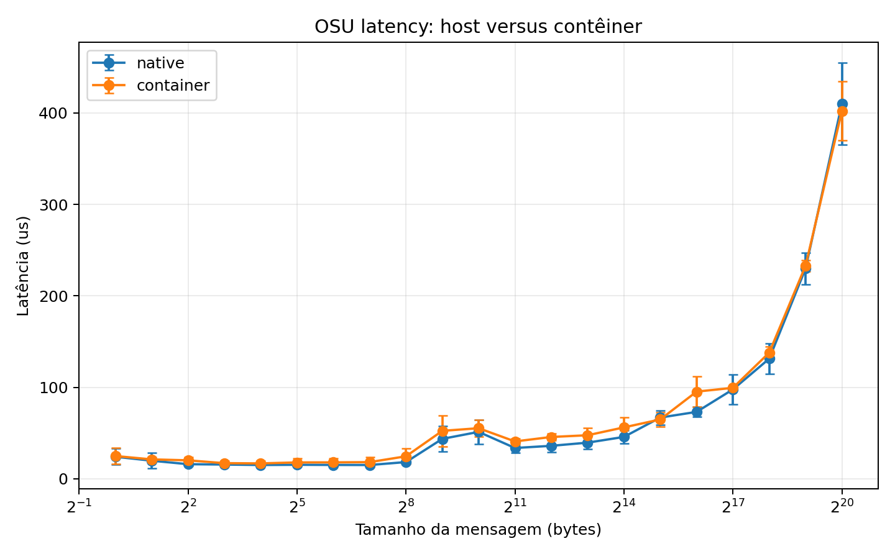

# Relatorio do piloto HPC: host e container

## Resumo executivo

Este relatorio documenta dois resultados relacionados: (i) um piloto
reproduzivel comparando host e container com o MPICH institucional
`CH4:OFI/libfabric`; e (ii) a validacao posterior do MPICH compilado com
`CH4:UCX`, motivada pelo baixo desempenho do piloto OFI.

O piloto OFI executou tres repeticoes de `osu_bw` e `osu_latency` em dois nos
PBS, com mensagens de 1 byte a 1 MiB. A maior banda do piloto foi 3425,24 MB/s,
ou 27,40% dos 100 Gb/s teoricos.

Na configuracao UCX, o MPICH nativo compilado com `CH4:UCX` detectou os
transports RDMA `rc_mlx5`, `rc_verbs` e `ud_mlx5`, atingindo aproximadamente
12,3 GB/s em mensagens grandes, equivalente a aproximadamente 98,4% de
100 Gb/s. A execucao UCX no container ainda nao foi valida: o container nao
conseguiu abrir o dominio `mlx5_0`, caiu em transports TCP e falhou na
inicializacao MPI.

## Ambiente e reproducibilidade

| Item | Valor |
|---|---|
| Sistema | AlmaLinux 8.10 |
| CPU computacao | AMD EPYC 7443, 48 CPUs |
| GCC | 9.4.0 |
| MPICH institucional | 4.1.1, `CH4:OFI/libfabric` |
| MPICH experimental | 4.1.1, `CH4:UCX` |
| libfabric | 1.18.0 |
| UCX | 1.15.0 |
| OSU | 7.5.2 |
| PBS | 22.05.11 |
| Fila | `paralela` |
| Alocacao | 2 nos, `scatter:exclhost` |
| Launcher | Hydra via `mpiexec` |
| Singularity | 3.8.5-2.el8 |
| Rede | InfiniBand HDR100, 100 Gb/s |

Arquivos relevantes:

- Receita HPCCM: `container/recipe-offline.py`.
- Definicao gerada: `container/Singularity.offline.def`.
- Spack: `spack/phase3-env/spack.yaml` e `spack/phase3-env/spack.lock`.
- Script PBS do piloto: `pbs/run_pilot_benchmarks.pbs`.
- Script PBS UCX: `pbs/run_ucx_benchmarks.pbs`.
- Parser: `scripts/parse_osu.py`.
- Graficos: `scripts/plot_results.py`.
- Logs nativos: `results/raw/pilot-native-1028628/`.
- Logs do container: `results/raw/pilot-container-1028771/`.
- CSV combinado: `results/processed/summary.csv` e `results/processed/measurements.csv`.

O lockfile real confirma:

```text
mpich@4.1.1%gcc@9.4.0 device=ch4 netmod=ucx
```

O MPICH UCX manual foi compilado com `--with-device=ch4:ucx`, usando UCX
1.15.0 e GCC 9.4.0. A tentativa de instalacao completa pelo Spack ainda teve
limitacoes de bootstrap/download de dependencias, mas a especificacao e o
lockfile foram preservados.

## Procedimento

### Piloto OFI

Os jobs usaram dois nos PBS e tres repeticoes por benchmark. Os parametros
foram:

```text
-m 1:1048576 -x 10 -i 100
```

O container foi uma base Ubuntu 24.04 SIF com MPICH, libfabric, RDMA e OSU
montados explicitamente do host. Ele nao e uma imagem autocontida.

### Validacao UCX

O MPICH nativo foi recompilado com `CH4:UCX`. A execucao nativa detectou:

```text
rc_mlx5
rc_verbs
ud_mlx5
mlx5_0:1
```

O fluxo UCX fixa `UCX_TLS=rc,sm,self` e `UCX_NET_DEVICES=mlx5_0:1`, alem de
registrar `mpichversion`, `ucx_info`, `fi_info` e `ldd`.

## Resultados do piloto OFI

### Largura de banda e latencia em 1 MiB

| Cenario | Benchmark | Media | Desvio-padrao | Minimo | Maximo |
|---|---|---:|---:|---:|---:|
| Host | `osu_bw` | 3250.81 MB/s | 10.86 | 3239.02 | 3260.40 |
| Container | `osu_bw` | 2842.40 MB/s | 590.40 | 2244.71 | 3425.24 |
| Host | `osu_latency` | 410.16 us | 45.00 | 381.32 | 462.01 |
| Container | `osu_latency` | 402.26 us | 32.05 | 365.48 | 424.21 |





Os graficos acima correspondem ao piloto OFI, com mensagens ate 1 MiB. Eles
nao devem ser interpretados como os graficos finais do estudo UCX.

## Analise

### Influencia do tamanho da mensagem

Para mensagens pequenas, custos fixos de MPI, protocolo e buffers dominam a
transferencia. Conforme a mensagem cresce, esses custos sao amortizados e a
largura de banda aumenta. A latencia fica relativamente estavel nas mensagens
pequenas e cresce para mensagens maiores.

No piloto OFI, a largura de banda se aproximou da estabilizacao entre 512 KiB
e 1 MiB. A faixa acima de 1 MiB nao foi considerada no piloto porque o
`osu_bw` OFI nao progrediu de forma confiavel ate 64 MiB.

### Maior largura de banda e percentual teorico

No piloto OFI, a maior medida foi no container, em 1 MiB:

```text
3425.24 MB/s
3425.24 / 12500 * 100 = 27.40%
```

A maior medida nativa OFI foi 3260,40 MB/s, equivalente a 26,08%.

Na validacao nativa CH4:UCX, a maior banda registrada foi aproximadamente
12,3 GB/s em mensagens grandes:

```text
12.3 / 12.5 * 100 = 98.4%
```

Esse resultado mostra que a rede e o caminho UCX nativo conseguem se aproximar
do limite teorico. Ele nao deve ser misturado com as medias do piloto OFI.

### Host versus container

No piloto OFI, a banda media do container foi aproximadamente 12,56% menor que
a nativa. A latencia media do container foi aproximadamente 1,93% menor, uma
diferenca pequena diante da variabilidade. A banda do container foi menos
consistente: seu intervalo em 1 MiB foi 2244,71--3425,24 MB/s, contra
3239,02--3260,40 MB/s no host.

Ainda nao e possivel fazer a comparacao final host versus container em UCX. O
container UCX nao abriu o dominio verbs `mlx5_0`, mostrou fallback TCP e falhou
com `Destination is unreachable`. Um resultado TCP nao e aceito como
comunicacao InfiniBand.

### Distancia ao limite teorico

O piloto OFI ficou distante do limite por causa de uma combinacao possivel de
provider OFI, protocolo MPI, PCIe, NUMA, afinidade, copias de memoria,
congestionamento, carga dos nos, firmware, driver e variacao do scheduler.

O resultado UCX nativo, proximo de 98,4%, indica que a principal causa do baixo
piloto era o caminho de comunicacao/configuracao, e nao necessariamente a
capacidade fisica da rede.

## Entregaveis

- Receita HPCCM e definicao Singularity.
- `spack.yaml` e `spack.lock` reais.
- Scripts PBS do piloto e do fluxo UCX.
- Logs completos do piloto nativo e do container OFI.
- CSVs processados.
- Graficos do piloto OFI.
- Script Python de processamento e graficos.
- Manifesto da compilacao MPICH `CH4:UCX` e OSU.

## Limitacoes e trabalho futuro

- O piloto host/container usa `CH4:OFI/libfabric`.
- O MPICH nativo UCX foi validado e atingiu aproximadamente 12,3 GB/s.
- O container UCX ainda nao acessa `mlx5_0` e nao possui resultado valido.
- O SIF usa binds do host e nao e autocontido.
- A versao exata do MOFED nao foi observavel com a conta de usuario.
- Ainda falta repetir o conjunto final UCX no host e no container com logs
  completos e graficos correspondentes.

## Conclusao

O piloto OFI confirmou execucao MPI nativa e em container entre dois nos, mas
apresentou apenas 26--27% do limite teorico. A recompilacao nativa do MPICH
com `CH4:UCX` e UCX 1.15.0 elevou a banda para aproximadamente 98,4% do limite
de 100 Gb/s e confirmou transports RDMA `mlx5`.

Assim, o feedback sobre explorar as opcoes de compilacao foi confirmado: a
configuracao do MPICH/netmod teve impacto decisivo. O trabalho ainda nao esta
completo para a comparacao final em container, pois o ambiente UCX dentro do
container precisa enxergar `mlx5_0` sem fallback TCP.
